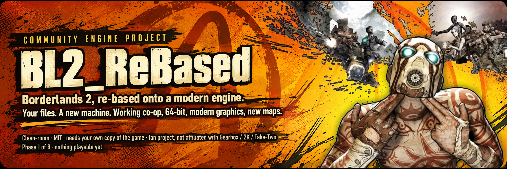
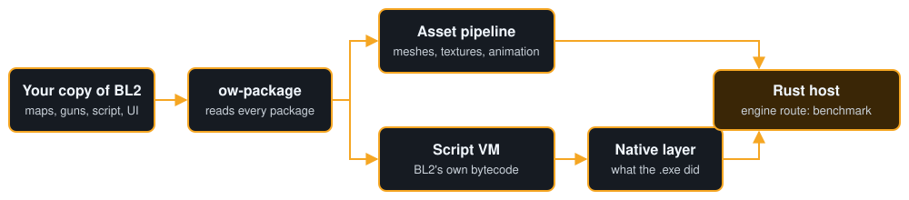

<div align="center">

<!-- Logo: pending hub decision. The untracked .github/assets/BL2_ReEngine-logo-512.png is the maintainer's file and is not used here. -->



# Borderlands 2 ReBased

### Same game. New machine.

**Borderlands 2's own files, read from your copy of the game, with a new engine underneath being written in Rust.**<br>
One developer, a lot of AI, and a written record of every check.

[](#where-things-stand)
[](#where-things-stand)
[](rust-toolchain.toml)
[](docs/decisions/2026-11/2026-11-15-01-engine-route-own-engine-on-wgpu-and-winit.md)
[](CMakeLists.txt)
[](https://github.com/zuhuHix/BL2_ReBased/actions/workflows/ci.yml)
[](LICENSE)
[](https://github.com/zuhuHix/BL2_ReBased/commits/main)
[](https://github.com/zuhuHix/BL2_ReBased/discussions)
[](https://buymeacoffee.com/zuhu)

[See it](#see-it-running) · [The numbers](#the-numbers) · [What is this?](#what-is-this) · [The loop](#the-loop-ran-in-the-ue5-host) · [Pictures](#progress-in-pictures) · [How close?](#how-close-is-it) · [Status](#where-things-stand) · [Roadmap](#roadmap) · [Legal](#is-this-legal) · [Support](#help-me-keep-going) · [Developers](#for-developers)

</div>

---

> [!NOTE]
> **2026-11-14: the project moved from Unreal Engine 5 to Rust.** The UE5 host has been removed from the repository ([the decision](docs/decisions/2026-11/2026-11-14-01-rust-replaces-the-ue5-host-engine-route-by-benchmark.md)). What that means:
>
> - The pictures on this page, "See it running" included, were made with the retired UE5 host. They show what that host did, not a build you can get today.
> - The Rust host is not running yet. On 2026-11-15 I picked the engine it builds on from a benchmark: our own engine on wgpu + winit, not Bevy ([decision](docs/decisions/2026-11/2026-11-15-01-engine-route-own-engine-on-wgpu-and-winit.md)). The host itself isn't written yet.
> - The part that reads the game carries over: the package reader, the script VM and the combat, mission and item rules. It's being ported from C++ to Rust crate by crate, and the C++ version stays the reference until each Rust crate matches it.
> - The last commit with the UE5 host is `08bcf3e`, if you want to look at it.

## See it running

*These frames are from the retired UE5 host (see the note above). The Rust host doesn't render anything yet.*

<p align="center">
  
</p>
<p align="center">
  
  
  
</p>
<p align="center"><sub>Frames captured from this project's UE 5.8 build on <code>main</code> (7eee9ee), 2026-11-07: Phaselock's cast, the Fire mission's reward screen, Fight For Your Life and a shotgun shot. The models, textures and UI movies were imported on my PC from my own copy of the game. This is not concept art and not a mod of the old .exe. It does not match the original yet: <a href="#how-close-is-it">here's the scoreboard</a>.</sub></p>

> [!IMPORTANT]
> **There is no game to play yet, and no download.** The retired UE5 host was a developer prototype: one map, one Vault Hunter and one mission, with labelled stand-ins, and most of its rules not yet confirmed against the original game. The Rust host that replaces it doesn't run yet. I put it up early so people can watch it grow.
>
> This is a fan project, not affiliated with Gearbox, 2K or Take-Two. No game files and no Gearbox code live in this repo. It only works against **your own purchased copy** of Borderlands 2, and it never touches your install.

## The numbers

<table>
  <tr>
    <td align="center" width="33%"><h3>2,008 / 2,008</h3>game packages read with zero errors, base game plus every DLC</td>
    <td align="center" width="33%"><h3>12,968 / 12,978</h3>of BL2's script functions decode structurally</td>
    <td align="center" width="33%"><h3>14 / 14</h3>links of the spawn-to-respawn loop passed in the retired UE5 host, in four runs on <code>main</code></td>
  </tr>
  <tr>
    <td align="center"><h3>69 / 69</h3>weapon cards match the real game's four main stats, with live values (every printed stat on 68)</td>
    <td align="center"><h3>112</h3>dated verification records in <a href="docs/verification/">docs/verification</a></td>
    <td align="center"><h3>750+ commits</h3>in the 58 days since the first one (2026-09-10)</td>
  </tr>
</table>

<sub>Automated checks on my own PCs, as of 2026-11-07. These numbers prove the pieces ran. They do not prove parity: a PASS means this engine did the thing, not that it matches Borderlands 2. The loop count comes from the retired UE5 host and does not count toward the Rust host's gates. The closeness is scored separately, in <a href="#how-close-is-it">How close is it?</a></sub>

## What is this?

Hey, I'm zuhu. Borderlands 2 is basically two separate things.

**The stuff:** maps, guns, characters, sounds, the story and the skill trees, the files sitting in your game folder right now. Honestly they're brilliant, and 14 years later people still love this game.

**The machine:** `Borderlands2.exe`, the 2012 program that loads all of that and turns it into a game. It's old, 32-bit and locked, running on a modified Unreal Engine 3. Nobody outside Gearbox can touch it.

Every big complaint people have (broken co-op, out-of-memory crashes, no ultrawide, no level editor) lives in the machine, not the stuff. Mods can change the stuff, and SDK mods can even hook the running game, but nobody outside Gearbox can recompile the machine.

**So this project builds a new machine.** I decode BL2's own files and build a new engine to run them, written in Rust. I'm not modelling copies of anything and I'm not remaking assets from scratch: I'm reading the originals and rebuilding the engine underneath them. Imagine what that opens up: new NPCs, new maps, new characters, new UI, reworked anything. This game deserves a third life.

Same idea as [OpenMW](https://openmw.org/) (Morrowind), [OpenRCT2](https://openrct2.org/) (RollerCoaster Tycoon 2) and [Ship of Harkinian](https://www.shipofharkinian.com/) (Ocarina of Time). Those work. As far as I know, nobody's done it for BL2 yet. That's the challenge.

<p align="center">
  
</p>

<sub>The target design. The game-reading core (package reader, script VM, combat, mission and item rules) is C++ today and is being ported to Rust. The host (the "host" in the docs) is not started in Rust: its engine route is picked (an own engine on wgpu + winit, from a benchmark), but none of it is written yet. Until 2026-11-14 the host was a UE5 project, now retired; in it, only parts of the slice ran on the script VM (backpack navigation, pieces of the Fire mission, and the combat rules in a command-line run).</sub>

<details>
<summary><b>Why can't mods just fix this?</b></summary>
<br>

Short version: my research estimates that mods could deliver about 80% of what players ask for (balance, QoL, new guns, sharper textures). That's an estimate, not a measurement. The rest is exactly the stuff people want *most*, and it's physically inside `Borderlands2.exe`:

- **Co-op** runs through a backend mods can't replace
- **64-bit** needs the engine recompiled, and only Gearbox can do that
- **Modern graphics** are blocked by the 2012 DirectX 9 renderer baked into the exe
- **New maps** need an editor that was stripped out before the game shipped

Full research: [docs/BL2_REMASTER_ANALYSIS.md](docs/BL2_REMASTER_ANALYSIS.md).

</details>

## The loop ran in the UE5 host

*This section is about the retired UE5 host. The Rust host has not run the loop, and its slice gate starts again from not started.*

The next big milestone is one complete loop on Sanctuary, as Maya:

<p align="center"><b>spawn → fight → loot → equip → Phaselock → finish a mission → go down → respawn</b></p>

The UE5 host had a test that chained all of it in a single session, and on 2026-11-07 it ran four times on `main` (twice plain, once with a test-fixture shield, once with a forced revive):

```text
slice gate: 14 PASS, 0 FAIL, 0 NOT_AVAILABLE of 14
```

Three days earlier the same suite said 10 of 14. That was the pace then.

**What that does not mean:** it's a scripted run, not a player, and it leans on named test fixtures such as teleports, a granted Phaselock point and forced loot. In those runs no enemy downed Maya: the down came from the test's own lethal damage. An unforced variant, which drops the forced loot, the granted point and the lethal damage but keeps the teleports, ran 8 times on 2026-11-11: the range's enemies downed her every time, and 5 of the 8 runs passed all 14 links. So the Phase 4 gate is not claimed as met. The full list of limits is in [SLICE_GATE.md](docs/verification/SLICE_GATE.md).

<details>
<summary><b>All 14 links, and the rest of that morning's results</b></summary>
<br>

`spawn_maya` → `reach_fight_area` → `kill_enemy` → `enemy_attacks_maya` → `loot_drop_on_kill` → `pick_up_gun` → `pick_up_aimed_not_nearest` → `equip_gun` → `phaselock_enemy` → `mission_accept` → `mission_objective` → `mission_turn_in` → `go_down` → `bleed_out_respawn`

All on `main` at 7eee9ee, on one PC, 2026-11-07. These are checks of this engine, not comparisons with the game.

| Check | Result |
|:--|:--|
| Slice gate, four runs | 14 pass / 0 fail / 0 not available, each |
| Gun range suite | 36 pass / 0 fail |
| Weapon firing suite | 14 of 14 guns |
| Marcus's mission screen | 21 of 21 (a first run failed 4 rows with the UI movie unavailable; the rerun with it passed) |
| Lootables and interactives | 11 pass / 0 fail |
| CTest, synthetic | 28 of 28 |
| `verify_packages.py` against the real install | 9 packages, class bodies exact |
| HUD tracker capture | **3 of 4**: its page check saw 6 of 7 states. Open |
| Phaselock frame capture | Frames written, but the script **exited 1** with no failure text. Not chased yet |

</details>

## Progress in pictures

> [!NOTE]
> **Everything in this section shows the retired UE5 host** (removed on 2026-11-14, last held by commit `08bcf3e`). "Ours" below means that host. The "State" lines describe what it did; the Rust host has none of it on screen yet. I'm keeping the pictures as a record and as the target the Rust host has to meet again.

*Where a real-game frame exists it sits next to ours, and each card says in its own text what still looks wrong. The newest cards (uploaded 2026-11-08) show our build 40ae631, captured 2026-11-07; their real-game frames come from my own sessions, and each card's footer says whether mods were on. Full-size frames are in the [`progress-gallery`](https://github.com/zuhuHix/BL2_ReBased/releases/tag/progress-gallery) release, not in the repository: they show game content, and the rules for that are in [docs/LEGAL.md](docs/LEGAL.md).*

<!-- Gallery images are release assets on the progress-gallery prerelease (uploaded by the maintainer). Not in the git tree. -->

### Sanctuary

**State:** Sanctuary is a walkable scene in UE5, and from a matched camera the geometry lines up with the real game. Lighting and materials are still approximations, and street life is missing.

<p align="center">
  
  
</p>
<p align="center"><sub><b>Real game first, then ours, from the same spot</b> (ours captured 2026-11-07). The buildings, the bench, the posters and the stairs are in place. Light, glow and colour are the big gap, and the citizens are off by default.</sub></p>

<details>
<summary><b>Earlier Sanctuary frames (September to early November)</b></summary>
<br>

<p align="center">
  
  
</p>
<p align="center"><sub><b>Left: BL2_ReBased. Right: the real game, same camera</b> (2026-10-22). The tower's graffiti, the NPC, Moxxi's neon and the colour grade are what's missing.</sub></p>

<p align="center">
  
  
</p>
<p align="center"><sub><b>Left: the real game (2026-09-22). Right: BL2_ReBased (2026-11-07).</b> The same street from different spots, cameras not matched. Ours is colder and flatter, and the road surface differs.</sub></p>

</details>

### Maya and Phaselock

**State:** Phaselock casts, locks and lifts a target. Its lift bob and its reload and weapon-swap rules are confirmed in the real game. The look is still being tuned.

<p align="center">
  
  
</p>
<p align="center"><sub><b>The cast and the hold, real game next to ours</b> (ours captured 2026-11-07). Same creature, different places. The real burst at the cast is much larger, and the real bubble is darker, with the target smaller inside it.</sub></p>

<p align="center">
  
  
  
</p>
<p align="center"><sub><b>How it got here.</b> <b>Left:</b> 2026-09-28, a purple bubble with nothing locked. <b>Middle:</b> 2026-11-06, a lifted bullymong; the target is too large and pale. <b>Right:</b> 2026-11-07, the cast's burst, on a test target.</sub></p>

### Missions

**State:** Marcus's mission screen is BL2's own movie. E opens it, Enter accepts, turns in and takes the reward. The Fire mission's stock world data drives it, with labelled stand-ins elsewhere in the loop.

<p align="center">
  
</p>
<p align="center"><sub><b>Rock, Paper, Genocide: Fire Weapons!, real game above, ours below</b> (ours captured 2026-11-07). The same pages and the same reward. Our camera misses Marcus, and the real pages have longer text. How the real screen behaves has its own record: <a href="docs/verification/MISSION_SCREEN.md">MISSION_SCREEN.md</a>.</sub></p>

### Guns

**State:** Guns are assembled from the game's own parts, and those parts set their firing modes. They hold about right at the hip, but aiming down sights and paint are well short of the game. The muzzle flash look is a host approximation, and per-surface impacts aren't done.

<p align="center">
  
  
</p>
<p align="center"><sub><b>The same four guns, built from the same parts, at the same pose on the same street</b> (ours captured 2026-11-07). Size and position at the hip are close. The street's colour and the guns' metal are well off, and the flash is drawn by the host, not with the game's own textures.</sub></p>

<details>
<summary><b>Older gun frames</b></summary>
<br>

<p align="center">
  
  
</p>
<p align="center"><sub>The four slice guns (left) and the assault rifle firing, casing in the air (right), both 2026-11-07. The metal is too pale, a known paint problem, and the weapon paint is <code>UNVERIFIED</code>.</sub></p>

<p align="center">
  
</p>
<p align="center"><sub>2026-10-04, an earlier build. The rows alternate: rows 1 and 3 are the real game (BL2's own HUD and minimap), rows 2 and 4 are ours, each pair showing the same gun.</sub></p>

</details>

### Enemies and the gun range

**State:** A test range outside Sanctuary has five stock enemies that notice Maya, approach, hit her and drop loot on death. BL2 has no such range, so there's nothing in the game to compare it with, and the AI rules are host-side and partly `UNVERIFIED`.

<p align="center">
  
</p>
<p align="center"><sub><b>The same creature from the game's files, real game left, ours right</b> (ours captured 2026-11-07). Different places and moments: ours is still in the air after a Phaselock, and its fur reads brighter than the real one.</sub></p>

<p align="center">
  
  
</p>
<p align="center"><sub>Five enemies on the rise (left) and a bullymong in mid-leap (right), 2026-11-07. The white enemies render pale, which is still an open question about their material, and this gun's paint is off.</sub></p>

### Skills

**State:** The skills page is navigable, spends points and runs its rules, with Quick Change respec at the placed machine. Some skill numbers come from live reads at level 8 only; the rest are `UNVERIFIED`.

<p align="center">
  
</p>
<p align="center"><sub><b>Real game left, ours right</b> (ours captured 2026-11-07). Same layout and same text, because it is the game's own menu movie reading the game's own strings. Maya is now drawn beside the page; the backdrop behind her still differs.</sub></p>

<details>
<summary><b>The same page a few days earlier</b></summary>
<br>

<p align="center">
  
  
</p>
<p align="center"><sub><b>Left: the real game (2026-10-21). Right: BL2_ReBased (2026-11-06).</b> Close in layout, with no character drawn on the page yet.</sub></p>

</details>

### Inventory

**State:** Inventory and status pages run on BL2's own movies, with the game's own card rows and rendered guns. This is the best-scoring whole screen so far.

<p align="center">
  
  
</p>
<p align="center"><sub><b>Left: the real game next to ours</b> (ours captured 2026-11-07), with a different row selected and a different backdrop. <b>Right: ours a month earlier (2026-10-09)</b>, when guns were silhouettes and the money was test values.</sub></p>

### HUD

**State:** The HUD is BL2's own Flash movie, run by Ruffle over UE5 and fed from host state. Nothing on it is redrawn. Some of the numbers it shows are stand-ins, and the cards say which.

<p align="center">
  
  
</p>
<p align="center"><sub><b>The everyday HUD and Fight For Your Life, real game left, ours right</b> (ours captured 2026-11-07). The HUD parts sit in the same places. Ours shows fewer minimap icons, has no mission running in the tracker, and its crosshair does not widen while firing. When Maya is down, the real screen loses its colour and hides the bars; ours doesn't yet.</sub></p>

### Vendors and lootables

**State:** Gun machines, the currency, the Ammo Dump and Dr. Zed sell. Containers open, and their contents come out. The shop page is a stand-in rather than BL2's own, and drops now lie inside the container they came from (#163), compared only in a few frames; the placement rule is unproven.

<p align="center">
  
  
</p>
<p align="center">
  
</p>
<p align="center"><sub><b>Lootable containers and a gun pickup, real game next to ours</b> (ours captured 2026-11-07), and our Ammo Dump (2026-11-06). The container models and the item card are the game's own. Each pair is from different places, and our opened containers show less loot and no prompt. Our shop page is a stand-in with our own lists, and there is no like-for-like real-game shop frame published yet.</sub></p>

## How close is it?

An independent AI critic, one that didn't build the thing, gets our frames and matched frames from the real game and scores them out of 10. **The target is 8.** Every score below was given to frames from the retired UE5 host, so it says how close that host got. The Rust host has no scores yet and starts from zero on this table. The first rule is that a score isn't parity: it's a judgement, it moves by a few tenths between rounds, and each row only covers what its record says.

| Part | Score | What it covers |
|:--|:-:|:--|
| Gun at the hip |  | Idle pose and framing of three guns, not paint ([record](docs/verification/WEAPON_VISUALS.md)) |
| Inventory and menus |  | Round 25. 8.21 if you ignore gun paint and render colour ([record](docs/verification/INVENTORY_MOVIE_PROTOTYPE.md)) |
| Gun paint |  | Side views against the real Inspect frame ([record](docs/verification/WEAPON_VISUALS.md)) |
| Phaselock |  | Round 24 at the default facing ([record](docs/verification/PHASELOCK_STOCK_DATA.md)) |
| Sanctuary |  | Eight matched cameras ([record](docs/verification/SANCTUARY_SCENE_IMPORT_GAPS.md)) |
| Aiming down sights |  | Pose and framing of four guns ([record](docs/verification/WEAPON_VISUALS.md)) |

<sub>Green means the target is reached. Only the hip pose got there, in the UE5 host, and only for pose and framing.</sub>

**Measured in the real game itself.** I drive the installed game through the community mod SDK and record what it actually does, the same kind of live read my mod [BL2_RTSE](https://github.com/zuhuHix/Bl2_RTSE) uses. That's how these became fact instead of guesses: the level curve, maximum health, skill points, the Fire mission's XP, Phaselock's lift bob and some of its cast conditions, and 69 weapon cards with their exact parts ([record](docs/verification/REALGAME_GROUND_TRUTH.md)). Phaselock's target scoring, and casting while injured or down, are not confirmed. Anything not confirmed like this stays labelled `UNVERIFIED` in the code and docs.

## Where things stand

*Updated 2026-11-15.*

**Short version:** there's no game to play yet. On 2026-11-14 the UE5 host was removed and the project switched to Rust ([decision](docs/decisions/2026-11/2026-11-14-01-rust-replaces-the-ue5-host-engine-route-by-benchmark.md)). Right now:

- **The host is back to not started, but its engine is picked.** A benchmark built the same small Sanctuary-and-Maya scene in Bevy and in an own engine on wgpu + winit, and on 2026-11-15 I picked the own engine on wgpu + winit ([record](docs/verification/ENGINE_BENCHMARK.md), [decision](docs/decisions/2026-11/2026-11-15-01-engine-route-own-engine-on-wgpu-and-winit.md)). Its main draws: BL2's Flash UI runs through Ruffle on the same GPU device, and the binary is several times smaller. None of its crates is in the repository yet.
- **The core carries over.** The package reader, the census, the VM prototype and the combat, mission and item rules keep their status. They're C++ today and get ported to Rust crate by crate. The Rust workspace exists, but its crates are skeletons: no Rust code reads a package yet.
- **The evidence stays.** Real-game captures, the own-words native notes and the script disassembly don't depend on the host. What the UE5 host showed stays on record as history and as a target, but doesn't count toward the Rust host's gates.

Before the switch, the Sanctuary slice in the UE5 host was a developer prototype that covered the whole loop in a scripted run, on labelled stand-ins and with most rules still unconfirmed against the game.

<details>
<summary><b>What the retired UE5 host did, part by part (as merged to <code>main</code> up to <code>08bcf3e</code>)</b></summary>
<br>

Each item names its PR. Anything not checked against the running game is `UNVERIFIED` in its record. Rules that live in the core (the VM's down and respawn rules, item and combat rules) carry over; the host parts (rendering, input, HUD wiring, movement) have to be built again in Rust.

- **Maya.** Movement numbers from the stock data (#77). Shield, health and Fight For Your Life in one host state (#72), a stand-in capacity for shields without a capacity stat (#124). Melee on V (#129). Stock frag grenades on G (#115, #123). A respawn charges the fee and shows a message (#151).
- **Down and respawn.** The down, bleed-out, second-wind and respawn rules run on the VM (#59, [COMBAT_DOWN_RESPAWN.md](docs/verification/COMBAT_DOWN_RESPAWN.md)).
- **HUD.** BL2's movie HUD by default (#54), the mission tracker and Fight For Your Life in the movie (#63), damage arrows and the level-up banner (#67), the shield bar (#80), BL2's minimap clip (#53), the Map screen (#97), use prompts (#131), a use target that follows the view on machines, lootables, stations and doors (#159), M and L keys (#117), and Phaselock's cooldown on the movie (#47, #146).
- **Guns.** Four slice guns with ADS, reload clips and muzzle flash (#48, #68). Guns built from the game's own parts (#57, #58, #86). Firing from the parts, including elemental explosions (#56, #70). Bullets carry momentum (#62). Generated guns get a view model, arms clips, the damage stack, the refire rule, their firing block and their accuracy pool (#141, #144, #145, #137, #130, #136, #142). An iron-sight ADS height fit, marked as a fit (#150).
- **Pickups and drops.** BL2's own card movie on world pickups (#95). E takes the aimed pickup, not the nearest (#101). Drops have a rarity beam and lie on the ground (#139).
- **Gun range.** Moving enemies with AI, loot on death from the VM's death roll (#89), and five enemies including a Psycho, with corpses (#133).
- **Skills.** Keyboard navigation (#35, #49). Skill modifiers on Maya's survival stats (#93). Quick Change respec at the placed machine (#106). Some numbers from live reads at level 8 only (#116), and Converge's damage from one live read (#135).
- **Vendors and lootables.** Currency and stock persist (#87). The Ammo Dump and Dr. Zed sell, and ammo purchases fill the pools (#99). The shop keeps its selection rules and refusals on screen (#127). Lootable and pickup textures (#120). Drops lie inside the container they came from (#163), compared only in a few frames; the placement rule is unproven. The shelves for shields and grenade mods sell stand-in gear with no stats.
- **Phaselock.** Presentation and colour constants (#50, #94, #110), round 24 (#104), the target's six worn attachments (#113), and a held target's death ends the skill (#146). Lift bob and reload/weapon-swap rules are confirmed in the real game ([PHASELOCK_STOCK_DATA.md](docs/verification/PHASELOCK_STOCK_DATA.md)).
- **Inventory and menus.** Tab switching (#91, #92). VALUE thumbnails and card fits (#69). An item set that would leave the backpack without room is refused (#71). The Missions log (#64, #100). Status pages hide the first-person gun (#118). A missing UI movie no longer covers the game (#122). Status menu keys keep each page on its own key and route between pages from the Inventory (#158).
- **The Fire mission.** Accept, objective and turn-in run on stock world data with labelled stand-ins ([SANCTUARY_RPG_MISSION.md](docs/verification/SANCTUARY_RPG_MISSION.md)), through Marcus's mission screen on BL2's own movie (#134).
- **Audio.** The host plays sounds by role (#119), and the game's own sounds can be decoded on your machine by an external tool, with the host wired to play them (#166). Playback in a run has not been checked yet, and nobody has listened to them against the game. Which roles exist comes from one live session, `UNVERIFIED` (#149).

</details>

**In progress:** work not yet on `main` is in the [open PRs](https://github.com/zuhuHix/BL2_ReBased/pulls).

**Not yet:**

- **A Rust host.** The engine route is picked (own engine on wgpu + winit), but nothing renders, moves or plays in the repository's Rust yet.
- **Parity with the original game.** Nothing here should be read as "it works like the real thing" unless its record says so.
- **An enemy that actually downs Maya in the gate run.** In the UE5 host, enemies hit her on the range, but the gate's down still came from the test.
- **The rest of the game.** The other ~79 maps, the other Vault Hunters, the full campaign, co-op, your saves.

**Next up:** porting the C++ core to Rust crate by crate until each crate matches it, starting the host on wgpu + winit, then Sanctuary and Maya again in the Rust host. The order is the same as before: Sanctuary and Maya first, then the Phase 4 gate, then breadth. The small items are tagged *good first task* in [ROADMAP.md](ROADMAP.md#now--next).

## What you'd get (eventually)

**The first milestone is the goal:** walk around Sanctuary as Maya, grab a gun, Phaselock something and finish a mission, all running on BL2's own game code in the new engine. The retired UE5 host got parts of it running; the Rust host has none of it yet. Everything below comes after that. It's not a remaster and it's not a remake; here's what a new machine is meant to buy you. These are goals, and none of them exist yet:

<table>
  <tr>
    <td width="50%"> <b>Co-op that works.</b> No SHiFT, no forced account linking, no hardlock on the title screen.</td>
    <td width="50%"> <b>64-bit.</b> The ~4 GB memory wall behind a lot of the crashes and Ultra HD pack problems: gone.</td>
  </tr>
  <tr>
    <td> <b>Modern graphics.</b> Real ultrawide, any resolution, unlocked framerate, optional modern lighting.</td>
    <td> <b>New maps.</b> BL2 never got a level editor. A new engine can have one; with the UE5 host gone, that editor has to be built or brought in.</td>
  </tr>
  <tr>
    <td> <b>Your mods carry over.</b> BLCMM text mods edit the same data we load, so they should come along. Not tested yet.</td>
    <td> <b>Your saves carry over.</b> Real save files, same characters.</td>
  </tr>
  <tr>
    <td> <b>It can't be cancelled.</b> If the servers go, the game keeps working.</td>
    <td> <b>The Pre-Sequel too.</b> Same engine underneath, comes along later for free.</td>
  </tr>
</table>

## Roadmap

Six phases. Each one ends with a gate, a thing you can actually see or do, so it's always clear whether this is moving.

**Current priority: a vertical slice, not breadth.** Porting all 82 maps is the easy part. The hard, unproven part is phases 2 through 4, actually running the game's code. So the goal right now is proving those on **one map and one Vault Hunter**, end to end, before spending more time on anything else ([why](ROADMAP.md#priority-the-vertical-slice)).

**Since the switch to Rust (2026-11-14),** the host half of phases 1 to 4 is back to not started, and the game-reading half (reader, VM, combat, mission and item rules) keeps its status. The priority order hasn't changed.

| Phase | What you'll be able to do | Where it is |
|:--|:--|:--|
|  **0 · Read the files** | The engine can open every BL2 file | **Done.** 2,008 packages, gated 2026-09-10, with the C++ reader. The Rust port has to match it before it takes over |
|  **0R · Pick the engine** | Bevy and an own engine on wgpu + winit each build the same small Sanctuary-and-Maya scene, and I pick from the measurements | **Picked 2026-11-15: own engine on wgpu + winit** ([record](docs/verification/ENGINE_BENCHMARK.md), [decision](docs/decisions/2026-11/2026-11-15-01-engine-route-own-engine-on-wgpu-and-winit.md)). The Rust core port, the other half of 0R, is still in progress |
|  **1 · See a map** | Walk around Sanctuary in the Rust host, verified against the real game. The rest of the 82 maps come in phase 5 | **Not started in Rust.** The retired UE5 host loaded three maps as scenery and had matched-camera rounds of Sanctuary; that stays on record as the target |
|  **2 · Run the game's brain** | BL2's own gameplay code executes, scoped to the slice | **Core in progress, host not started.** A C++ bytecode loader, interpreter and Core natives since 2026-09-30, to be ported to Rust. In the UE5 host it drove backpack navigation and pieces of the mission and combat rules |
|  **3 · Make a body move** | Walking, jumping, falling, animation, collision, scoped to the slice | **Not started in Rust.** Movement numbers from stock data (#77) carry over; the UE5 host's movement was maintainer-tested on 2026-10-02, with no verification record |
|  **4 · One Vault Hunter, proven** | The full loop on Sanctuary. About 3,800 of Gearbox's undocumented functions have to be worked out. **This is the mountain** | **Core in progress, host not started.** The combat, mission and item rules carry over. The UE5 host's scripted loop passed 14 of 14 with stand-ins; that doesn't count for the Rust host |
|  **5 · Fill it out** | The remaining ~79 maps and 5 Vault Hunters, plus the whole campaign with your real save file | **Not started** |
|  **6 · Beyond** | Co-op, DLC, The Pre-Sequel, mods, level editor | **Not started** |

I work on this actively, and I'm not promising completion dates. Checkbox-level detail is in [ROADMAP.md](ROADMAP.md).

<details>
<summary><b>66 days, in dates</b></summary>
<br>

| Date | What happened |
|:--|:--|
| 2026-09-10 | The reader opens all 2,008 packages. Phase 0 gated, UE5 chosen |
| 2026-09-13 | Ash and Sanctuary load in UE5 as frozen scenes |
| 2026-09-14 | Placeholder walking with collision on Sanctuary |
| 2026-09-23 | Maya imported with animated first-person arms |
| 2026-09-30 | C++ bytecode loader, script VM and Core natives (prototype) |
| 2026-10-01 | The VM drives backpack navigation in UE5, and the Fire mission plays through |
| 2026-10-02 | First real-game captures: progression, Phaselock's bob and 69 weapon cards |
| 2026-10-22 | BL2's own HUD movie becomes the default HUD, with its minimap |
| 2026-11-04 | First run of the whole loop as one test: 10 of 14 links |
| 2026-11-06 | The gun range lands on `main`, with enemies that fight and drop loot |
| 2026-11-07 | The loop passes 14 of 14 on `main` |
| 2026-11-14 | The UE5 host is retired and the project moves to Rust. The engine route will be picked by benchmark |
| 2026-11-15 | Engine benchmark run; I pick an own engine on wgpu + winit over Bevy |

</details>

## Related project: BL2_RTSE

I also make [BL2_RTSE](https://github.com/zuhuHix/Bl2_RTSE), a mod for the real, installed Borderlands 2 that reads and hooks the running game through the Python SDK. I use it as a ground-truth tool here: when I want to know what the game does (a value, the order of events, what a native returns), I look at the live game first and only then decode packages or read native code. Anything it dumps stays on my machine and never goes in this repository.

## Help me keep going

This is a solo project, full stop. I live in Portugal and make about €1k a month, so spending a tenth of my salary on this every month just isn't realistic. AI does most of the decoding grunt work (I run a couple of ChatGPT setups I call Astra and Luna) and it's genuinely fast and good at this, that's how we got this far this quickly. But I'm on a €20/month subscription, and I can't just throw a chunk of my income at a passion project.

Borderlands 2 has always been my favourite game. My childhood game. This project is really close to my heart and I mean that sincerely. You can follow along and expect weekly updates, assuming I haven't burned through a month's AI usage in the first three days of the week. Which, uh, happened this week.

If you want to help me spend way more time on this (a better subscription, maybe eventually a game dev coach who can point me in the right direction) there's a Buy Me a Coffee link below. I also have a Patreon, but that one's more tied to my YouTube and TikTok stuff.

I'm not sure anyone actually reads this far, but if you did, thank you for checking the project out. I'm open to any constructive criticism, and if you feel like sending a PR, go for it.

[](https://buymeacoffee.com/zuhu)

## Is this legal?

I take this seriously. I'm not a lawyer, so this describes what the project does rather than giving a legal conclusion. I follow the same kind of rules as [OpenMW](https://openmw.org/) (Morrowind) and [OpenRCT2](https://openrct2.org/) (RollerCoaster Tycoon 2):

1. **I never share game files.** Not a texture, not a sound. Nothing extracted from the game *ever* enters this repository. Extracted assets live locally during import but stay git-ignored.
2. **No leaked source, and no code copied from the game's binary.** I read file formats, watch what the real game does, and (since 2026-10-01) analyse the game executable on my own machine to understand how its native code behaves. Decompiler output and analysis databases are game-derived data and stay out of this repository; the code in it is written from understanding, not from listings. One exception, my decision on 2026-11-19: the renderer's shaders under `crates/ow-render/shaders/ue3/` are translated from the UE3 shader source that ships with the game, so they are Epic Games' work, not MIT-licensed, and removed if Epic asks. I'm not a lawyer and none of this is legal advice; the risks are spelled out in [docs/LEGAL.md](docs/LEGAL.md).
3. **You need your own copy of BL2.** The engine refuses to start without it, and never modifies your install.
4. **I don't make money from this.** No paid builds, no premium anything. Ever. It's a passion project.
5. **Screenshots.** The git tree never holds screenshots of loaded game content. A small set of comparison screenshots, reviewed before upload, is published as assets on the `progress-gallery` prerelease, outside the tree. No game files or extracted assets are ever published, and any gallery asset is removed at the rights holder's request. This states what the project does, not a legal conclusion. Full scope: [docs/LEGAL.md](docs/LEGAL.md).

Full policy: [docs/LEGAL.md](docs/LEGAL.md). License: [MIT](LICENSE). Covers my code, nothing else.

<details>
<summary><b>FAQ</b></summary>
<br>

**Can I play Borderlands 2 in this?**
Not yet. There's no download. Until 2026-11-14, on my machines, Maya could walk Sanctuary, shoot enemies on a test range, loot a gun and run one mission in the UE5 host, but that was a developer harness, not the game, and that host is now retired. The Rust host doesn't run yet. The full campaign is Phase 5. It's gonna be a while...

**Is this a remaster? A remake?**
Neither. A remaster re-does the *stuff* (new textures, new models). A remake rebuilds everything from scratch. This keeps the original stuff untouched and replaces only the *machine* that runs it. Remasters will follow later on when people enjoy their new modding capabilities.

**Will my mods work?**
That's the plan, but it hasn't been tested. Text mods edit the same game data this loads, so they should carry over once gameplay runs (Phase 4–5). SDK mods will need a compatibility layer later. How many mods come along isn't known yet.

**Will my saves work?**
That's the plan, but not yet. Reading and writing real save files is a Phase 5 task and hasn't been validated. The save format is already documented by the community.

**Why Rust? Wasn't this on Unreal Engine 5?**
It was, until 2026-11-14. Borderlands 2 is Unreal Engine *3*, and the first plan translated its systems into their UE5 descendants. After playing the slice by hand I decided to move the runtime code to Rust instead: the game-reading core gets ported from C++, and the engine underneath was picked by a benchmark rather than up front: on 2026-11-15, our own engine on wgpu + winit over Bevy ([that decision](docs/decisions/2026-11/2026-11-15-01-engine-route-own-engine-on-wgpu-and-winit.md)). The switch itself is [here](docs/decisions/2026-11/2026-11-14-01-rust-replaces-the-ue5-host-engine-route-by-benchmark.md). The UE5 work isn't thrown away: its code is still in the history (commit `08bcf3e`) and its records say what it did, which is the target the Rust host has to meet.

**Who's making this?**
Me and AI: ChatGPT (Astra and Luna) and Claude as well (Opus 5.5 and Sonnet 5.5) do the grunt work, decoding formats and chasing down smaller one-off tasks. If you want to help cover my monthly sub, or just support the hours going into this, there's a [Buy Me a Coffee](https://buymeacoffee.com/zuhu). Thank you so much to my current supporter (George)! <3

**Why "ReBased"?**
Come on guys, it's obvious hahaha. (The code still uses the working title *OpenWillow* in identifiers like `ow-package`; "Willow" is Gearbox's internal name for the BL2 engine.)

**What if it fails?**
I don't plan to stop ([the plan's commitment](docs/OPENWILLOW_ENGINE_PLAN.md#9-commitment)). If it ever does fail, the repo will say so, and the research and tools stay useful to the modding community.

But to be fair, like, c'mon, there is no way this fails and I'll push through the whole way. Also, with newer and better AIs it's gonna get faster and easier every day!

</details>

---

## For developers

Everything below is the technical layer. Click to expand.

<details>
<summary><b>How it works: architecture</b></summary>
<br>

Measured directly from the installed game: 20,119 functions across the nine code packages. **12,978 (64.5%) are UnrealScript bytecode**, meant to run in our VM as-is (today the VM is partial, and it decodes all but 10 of them). **7,141 (35.5%) were native C++** inside `Borderlands2.exe` and must be rebuilt. Of those, 286 are trivial builtins, 609 are online/save/DLC plumbing we replace rather than replicate, 512 bridge the Scaleform UI, 1,914 are stock UE3 natives whose contracts are public via UDK, and **3,803 are Gearbox's own, undocumented**. Full breakdown: [engine plan §0](docs/OPENWILLOW_ENGINE_PLAN.md#0-ground-truth-the-numbers-this-plan-rests-on).

Three layers. The script VM and the asset pipeline are engine-agnostic (C++ today, being ported to Rust); the native layer is where the host engine shows up.

```
                 ┌──────────────────────────────────────────────────────┐
                 │  HOST ENGINE (Rust; own engine on wgpu + winit)      │
                 └───────────────▲──────────────────────▲───────────────┘
                                 │                      │
   ┌─────────────────────────────┴───┐    ┌─────────────┴──────────────────┐
   │  NATIVE LAYER (Rust)            │    │  ASSET PIPELINE  ◄── Phase 1   │
   │  the 7,141 rebuilt functions    │    │  package loader (UPK/TFC)  [done] │
   │  Actor/Pawn/Controller, traces, │    │  textures, static meshes   [done] │
   │  movement, animation, particles,│    │  materials (approximation) [wip]  │
   │  AI, stat core, weapons, UI     │    │  levels (actors+transforms)[wip]  │
   └─────────────────────────────▲───┘    │  skeletal, anim, lightmaps,    │
                                 │        │  Kismet, Wwise, Bink, SWF  [todo] │
   ┌─────────────────────────────┴───┐    └────────────────────────────────┘
   │  UNREALSCRIPT VM  ◄── Phase 2   │
   │  UObject model, bytecode        │
   │  interpreter, states, latents,  │
   │  native dispatch table          │
   └─────────────────────────────────┘
        goal: run the 12,978 inherited functions unchanged
```

Until 2026-11-14 the host engine was Unreal Engine 5, chosen at the Phase 0 gate. That choice was reversed: new runtime code is Rust, the UE5 host is removed (last held by commit `08bcf3e`), and the Rust engine route was picked on 2026-11-15 from a Phase 0R benchmark that built the same small scene in Bevy and in an own engine on wgpu + winit: the own engine on wgpu + winit ([decision](docs/decisions/2026-11/2026-11-15-01-engine-route-own-engine-on-wgpu-and-winit.md)). The `[done]` and `[wip]` marks in the diagram are the C++ core's; the host-side ones were done in UE5 and have to be done again. Reasoning: [the decision](docs/decisions/2026-11/2026-11-14-01-rust-replaces-the-ue5-host-engine-route-by-benchmark.md) and [engine plan §2.1](docs/OPENWILLOW_ENGINE_PLAN.md#21-host-engine-decision).

</details>

<details>
<summary><b>How we build it: methodology</b></summary>
<br>

Analyse freely, publish only our own code. File formats, observed behaviour and (since 2026-10-01) analysis of the game executable are all fair sources for *understanding* what the game does. Raw decompiler output and analysis databases stay local, because they're game-derived data, and the code in this repo is written from our own notes, never pasted or converted from a listing. No leaked source. When a public reference implementation (UE Viewer, UDK headers) helps pin down a serialization *order*, we read it (never copy from it) and log the source and its license in [THIRD_PARTY.md](THIRD_PARTY.md). The practical side, including how to share local analysis between two machines, is in [docs/NATIVE_ANALYSIS.md](docs/NATIVE_ANALYSIS.md).

Every rebuilt native function needs a definition of "correct," and there are three we'll accept. **UDK**, a free running copy of UE3, covers the 1,914 stock natives. **The original game, instrumented** with [unrealsdk](https://github.com/bl-sdk) confirms the rest: hook a function, log what goes in and out during real play, then implement until our engine reproduces that log. **Community documentation** (the BLCM wiki, bl2.parts, Lootlemon) fills in stat math the other two don't reach. Reading the native function itself is now the fastest way to *find* the rule; it doesn't replace the check. A rule read from native code and not yet confirmed by one of the three stays labelled `UNVERIFIED` until it earns that label removed.

That standard isn't just for natives. Every change gets the checks that fit it, and they get written down: synthetic tests in CI, differential checks against a real install, host runs, and comparisons with the real game where they exist. Each record says which of these it has. [DECISIONS.md](DECISIONS.md) is the record of all of it: every architectural choice, what got verified, and what didn't.

It's a one-person project, and I'm not quiet about the tooling. I own every architectural call, every verification and every license or provenance decision myself, but day to day, ChatGPT (Astra and Luna) handles format decoding and smaller one-off tasks, and Claude handles keeping the project organized plus last-resort coding once I've burned through a month's usage on my plan. Both operate under a written brief ([AGENTS.md](AGENTS.md), which [CLAUDE.md](CLAUDE.md) imports) and guard hooks in [`.claude/`](.claude/). Since 2026-09-30 an assistant may edit the package reader, container code and `CMakeLists.txt` and must then name the change and what is verified in its final message; the hooks still prompt me for license, dependency and provenance files and block game-file and decompiler-database writes.

</details>

<details>
<summary><b>The numbers behind the status</b></summary>
<br>

Every claim above comes from a dated verification record. Automated checks are reported separately from "a human looked at it," and anything unverified is labelled `UNVERIFIED` in the code and docs.

- **Phase 0, gated 2026-09-10.** The reader reads 2,008 of 2,008 packages: 4,751,329 serialized exports. Nine code packages decode byte-for-byte identically to an independent Python reader. Tagged properties on a real weapon part match BLCMM's dump. One mesh and one texture were extracted and rendered in UE 5.8 (the host of the time).
- **Phase 1, in the retired UE5 host.** `Ash_P`, `Sanctuary_P` and `SouthpawFactory_P` loaded as frozen scenes with a four-channel material approximation, an inspection lighting rig, a Sanctuary sky approximation, an opt-in outer-hull import and a free-flight camera. Saved scenes reopened with zero verification errors. A command-line selector lists 37 base-game maps (82 with `--include-dlc`), and an in-game Tab list switched between imported scenes. Walking was verified on Sanctuary only. Sanctuary ran at 12 to 15 FPS on an integrated-GPU laptop. In the Rust host, Phase 1 is not started.
- **Slice gate, 2026-11-07.** `tools/test_slice_gate.ps1` on `main` at 7eee9ee, four runs: 14 PASS, 0 FAIL, 0 NOT_AVAILABLE of 14, each. UE5 host behaviour only; it does not count toward the Rust host's gate.

Records: [decisions log](DECISIONS.md) · [Material v1 / Ash](docs/verification/MATERIAL_LEVEL_V1_VERIFICATION.md) · [Phase 1 viewer](docs/verification/PHASE1_VIEWER_VERIFICATION.md) · [cooked materials](docs/verification/COOKED_MATERIAL_VERIFICATION.md) · [map selection / Southpaw Factory](docs/verification/MAP_SELECTOR_VERIFICATION.md) · [UV / winding](docs/verification/UV_WINDING_VERIFICATION.md) · [collision and walking](COLLISION_WALKING_VERIFICATION.md) · [performance / in-game selector](docs/verification/PERFORMANCE.md) · [umodel cross-check](docs/verification/UMODEL_CROSSCHECK.md) · [object-dump cross-check](docs/verification/BLCMM_DUMP_CROSSCHECK.md) · [BSP texture axes](docs/verification/BSP_TEXTURE_AXES.md) · [slice gate](docs/verification/SLICE_GATE.md) · [gates and baseline](docs/verification/GATES.md).

The progress gallery's images are game content, so they are release assets and not in the repository (see [docs/LEGAL.md](docs/LEGAL.md)). Anyone with the game can reproduce the same kind of frame with the commands in [docs/TOOLING.md](docs/TOOLING.md).

</details>

<details>
<summary><b>Build and run it</b></summary>
<br>

You need: Windows, Rust 1.96 (pinned in [`rust-toolchain.toml`](rust-toolchain.toml); `rustup` picks it up), CMake, Visual Studio 2022 C++ build tools, Python 3, and an installed Borderlands 2. Unreal Engine is not needed any more.

The Rust workspace (crates under `crates/`, no third-party crates yet):

```powershell
cargo build --workspace
cargo test --workspace                                         # synthetic tests, no game needed
```

`ow-host --game <install folder>` is the host on the chosen route (own engine on wgpu + winit). It checks that it was given a Borderlands 2 install, and its other commands draw a map's scene, walk Sanctuary headless, and run a play mode in the window or headless. What each command does, and what it does not prove, is in [docs/TOOLING.md](docs/TOOLING.md), "`ow-host`: the Rust host". None of it is checked against the game.

The C++ core in `src/` still builds and is the reference until each Rust crate matches it (same synthetic fixtures, same `verify_packages.py` results):

```powershell
cmake -S . -B build -G "Visual Studio 17 2022" -A x64
cmake --build build --config Release
ctest --test-dir build -C Release --output-on-failure          # synthetic tests, no game needed
python tools/verify_packages.py --reader build/Release/ow-package.exe   # needs the game
& ./build/Release/ow-package.exe "C:/Program Files (x86)/Steam/steamapps/common/Borderlands 2/WillowGame/CookedPCConsole/Core.upk"
```

Inspecting properties, running the full-install census, extracting a texture or mesh: [docs/TOOLING.md](docs/TOOLING.md). Everything the tools produce lands under `local/`, which is git-ignored, so extracted assets never enter the tree. The current pass/fail baseline for each gate is in [docs/verification/GATES.md](docs/verification/GATES.md).

The code keeps the working-title prefixes from before the rename: the reader is `ow-package`, the crates are `ow-*`, and the CMake option is `OPENWILLOW_LZO`.

</details>

<details>
<summary><b>What's implemented right now</b></summary>
<br>

A standalone x64 C++20 tool, `ow-package`, reads version 832/46 packages: name/import/export tables; fully and partially LZO-compressed containers; object records with outer paths; a `PackageStore` that indexes an install lazily and resolves imports across packages; per-class export census; tagged properties (scalars, object refs, nested and fixed-layout structs, arrays via a schema file); resident `Texture2D` mips to PNG (DXT1/DXT5/A8R8G8B8, inline or TFC-streamed); all render LODs of a `StaticMesh` and one LOD to OBJ; bulk scene metadata and bounded payload bytes for the level preparer.

`tools/prepare_level.py` follows a map's serialized sublevel references, extracts reusable mesh sections and four-channel materials, and writes a manifest.

The Rust workspace has 22 crates in their final shape, one per layer from `ow-core` up to `ow-cli` and `ow-host`, with their allowed dependency edges, module files and owner lanes listed in [crates/README.md](crates/README.md). The Rust `ow-package` (`ow-cli`) takes the C++ binary's command lines and reads the installed packages, and `ow-host` draws and walks a map: see [docs/TOOLING.md](docs/TOOLING.md), "Rust workspace" and "`ow-host`: the Rust host", and [docs/verification/GATES.md](docs/verification/GATES.md) for what each check covers. A command that meets a rule not ported yet exits 3 (`NotYet`). None of this is parity with the game. Until 2026-11-14 the Sanctuary slice (Maya's movement, HUD, guns, Phaselock, the gun range, the Fire mission, skills, vending and lootables) lived in the UE5 host under `host/ue5/`, with its 14-link slice gate. That host is removed; `git show 08bcf3e:<path>` recovers any of its files, and its records in [docs/verification/](docs/verification/) say what it did.

Not implemented in the core: runtime package streaming, other pixel formats, lightmaps, material graph translation, full UE3 collision parity, a general native layer, saves, and checked playback of the game's own sounds. The Rust host's state is in [docs/TOOLING.md](docs/TOOLING.md), "`ow-host`: the Rust host". (In the UE5 host, terrain and BSP were imported for Sanctuary only, and skeletal meshes came in through UModel for the slice's characters.)

Full detail and what each check does and does not prove: [docs/TOOLING.md](docs/TOOLING.md).

</details>

<details>
<summary><b>All the documents</b></summary>
<br>

- [ROADMAP.md](ROADMAP.md): checkbox-level tracker: done, next, blocked
- [DECISIONS.md](DECISIONS.md): dated log of every architectural and parsing decision and its evidence
- [docs/OPENWILLOW_ENGINE_PLAN.md](docs/OPENWILLOW_ENGINE_PLAN.md): the plan: numbers, architecture, sources of truth, phases, commitment
- [docs/BL2_REMASTER_ANALYSIS.md](docs/BL2_REMASTER_ANALYSIS.md): research: what players actually want, what modding can and cannot reach
- [docs/TOOLING.md](docs/TOOLING.md): every tool, flag and command, with what each check proves
- [docs/verification/](docs/verification/): dated verification records for each shipped slice
- [docs/verification/SLICE_GATE.md](docs/verification/SLICE_GATE.md): the Phase 4 loop, run end to end, link by link
- [docs/verification/GATES.md](docs/verification/GATES.md): gate commands and the current baseline
- [docs/LEGAL.md](docs/LEGAL.md): working rules (analysis allowed, no game data or transcribed code in the repo), non-affiliation, contributor certification, license
- [docs/NATIVE_ANALYSIS.md](docs/NATIVE_ANALYSIS.md): analysing the game executable, and sharing local analysis between two machines
- [THIRD_PARTY.md](THIRD_PARTY.md): dependency and reference provenance
- [CONTRIBUTING.md](CONTRIBUTING.md): how to contribute, and the sensitive areas
- [CODE_OF_CONDUCT.md](CODE_OF_CONDUCT.md): Contributor Covenant 2.1
- [research/](research/README.md): the community-demand fetch and analysis scripts (the Steam review text they fetch stays in ignored `local/`) and the original Python package reader

</details>

---

<div align="center">
<sub>BL2_ReBased is an independent fan project. Borderlands and related marks are trademarks of their respective owners. Not affiliated with, endorsed by or supported by Gearbox Software, 2K Games or Take-Two Interactive. Promotional artwork is used for identification only. Formerly "OpenWillow".</sub>
</div>
