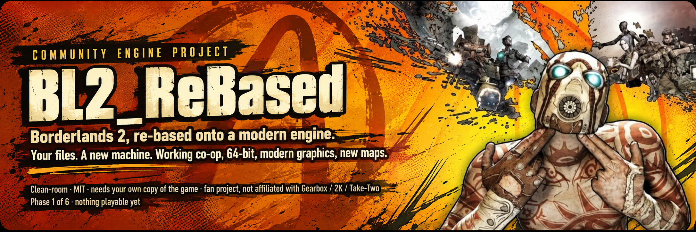
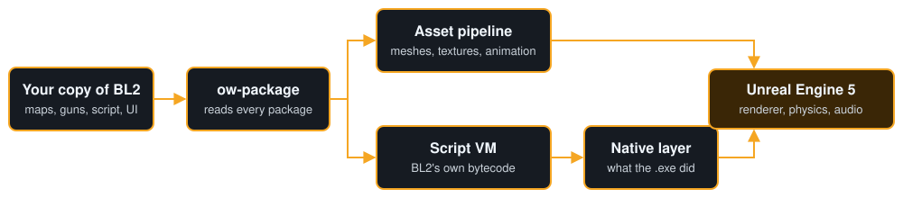

<div align="center">

<!-- Logo: pending hub decision. The untracked .github/assets/BL2_ReEngine-logo-512.png is the maintainer's file and is not used here. -->



# Borderlands 2 ReBased

### Same game. New machine.

**Borderlands 2's own files, read from your copy of the game and rebuilt on Unreal Engine 5.**<br>
One developer, a lot of AI, and a written record of every check.

[](#where-things-stand)
[](#where-things-stand)
[](docs/OPENWILLOW_ENGINE_PLAN.md)
[](CMakeLists.txt)
[](https://github.com/zuhuHix/BL2_ReBased/actions/workflows/ci.yml)
[](LICENSE)
[](https://github.com/zuhuHix/BL2_ReBased/commits/main)
[](https://github.com/zuhuHix/BL2_ReBased/discussions)
[](https://buymeacoffee.com/zuhu)

[See it](#see-it-running) · [The numbers](#the-numbers) · [What is this?](#what-is-this) · [The loop](#the-loop-already-runs) · [Pictures](#progress-in-pictures) · [How close?](#how-close-is-it) · [Status](#where-things-stand) · [Roadmap](#roadmap) · [Legal](#is-this-legal) · [Support](#help-me-keep-going) · [Developers](#for-developers)

</div>

---

## See it running

<p align="center">
  
</p>
<p align="center">
  
  
  
</p>
<p align="center"><sub>Frames captured from this project's UE 5.8 build on <code>main</code> (7eee9ee), 2026-11-07: Phaselock's cast, the Fire mission's reward screen, Fight For Your Life and a shotgun shot. The models, textures and UI movies were imported on my PC from my own copy of the game. This is not concept art and not a mod of the old .exe. It does not match the original yet: <a href="#how-close-is-it">here's the scoreboard</a>.</sub></p>

> [!IMPORTANT]
> **There is no game to play yet, and no download.** This is a developer prototype: one map, one Vault Hunter and one mission, with labelled stand-ins, and most of its rules are not yet confirmed against the original game. I put it up early so people can watch it grow.
>
> This is a fan project, not affiliated with Gearbox, 2K or Take-Two. No game files and no Gearbox code live in this repo. It only works against **your own purchased copy** of Borderlands 2, and it never touches your install.

## The numbers

<table>
  <tr>
    <td align="center" width="33%"><h3>2,008 / 2,008</h3>game packages read with zero errors, base game plus every DLC</td>
    <td align="center" width="33%"><h3>12,968 / 12,978</h3>of BL2's script functions decode structurally</td>
    <td align="center" width="33%"><h3>14 / 14</h3>links of the spawn-to-respawn loop pass, in four runs on <code>main</code></td>
  </tr>
  <tr>
    <td align="center"><h3>69 / 69</h3>weapon cards match golden values captured from the real game</td>
    <td align="center"><h3>112</h3>dated verification records in <a href="docs/verification/">docs/verification</a></td>
    <td align="center"><h3>743 commits</h3>in the 58 days since the first one (2026-09-10)</td>
  </tr>
</table>

<sub>Automated checks on my own PCs, as of 2026-11-07. These numbers prove the pieces run. They do not prove parity: a PASS means this engine did the thing, not that it matches Borderlands 2. The closeness is scored separately, in <a href="#how-close-is-it">How close is it?</a></sub>

## What is this?

Hey, I'm zuhu. Borderlands 2 is basically two separate things.

**The stuff:** maps, guns, characters, sounds, the story and the skill trees, the files sitting in your game folder right now. Honestly they're brilliant, and 14 years later people still love this game.

**The machine:** `Borderlands2.exe`, the 2012 program that loads all of that and turns it into a game. It's old, 32-bit and locked, running on a modified Unreal Engine 3. Nobody outside Gearbox can touch it.

Every big complaint people have (broken co-op, out-of-memory crashes, no ultrawide, no level editor) lives in the machine, not the stuff. Mods can change the stuff. They can't touch the machine.

**So this project builds a new machine.** I decode BL2's own files and bring them into Unreal Engine 5. I'm not modelling copies of anything and I'm not remaking assets from scratch: I'm reading the originals and rebuilding the engine underneath them. Imagine what that opens up: new NPCs, new maps, new characters, new UI, reworked anything. This game deserves a third life.

Same idea as [OpenMW](https://openmw.org/) (Morrowind), [OpenRCT2](https://openrct2.org/) (RollerCoaster Tycoon 2) and [Ship of Harkinian](https://www.shipofharkinian.com/) (Ocarina of Time). Those work. Nobody's done it for BL2 yet. That's the challenge.

<p align="center">
  
</p>

<sub>The target design. Today only parts of the slice run on the script VM (backpack navigation, pieces of the Fire mission, and the combat rules in a command-line run). The rest is C++ in the UE5 project (the "host" in the docs), with labelled stand-ins.</sub>

<details>
<summary><b>Why can't mods just fix this?</b></summary>
<br>

Short version: mods can deliver about 80% of what players ask for (balance, QoL, new guns, sharper textures). The remaining 20% is exactly the stuff people want *most*, and it's physically inside `Borderlands2.exe`:

- **Co-op** runs through a backend mods can't replace
- **64-bit** needs the engine recompiled, and only Gearbox can do that
- **Modern graphics** are blocked by the 2012 DirectX 9 renderer baked into the exe
- **New maps** need an editor that was stripped out before the game shipped

Full research: [docs/BL2_REMASTER_ANALYSIS.md](docs/BL2_REMASTER_ANALYSIS.md).

</details>

## The loop already runs

The next big milestone is one complete loop on Sanctuary, as Maya:

<p align="center"><b>spawn → fight → loot → equip → Phaselock → finish a mission → go down → respawn</b></p>

There's a test that chains all of it in a single session, and on 2026-11-07 it ran four times on `main` (twice plain, once with a shield, once with a forced revive):

```text
slice gate: 14 PASS, 0 FAIL, 0 NOT_AVAILABLE of 14
```

Three days earlier the same suite said 10 of 14. That's the pace right now.

**What that does not mean:** it's a scripted run, not a player, and it leans on named test fixtures such as teleports, a granted Phaselock point and forced loot. No enemy has downed Maya in it: the down comes from the test's own lethal damage. So the Phase 4 gate is not claimed as met. The full list of limits is in [SLICE_GATE.md](docs/verification/SLICE_GATE.md).

<details>
<summary><b>All 14 links, and the rest of that morning's results</b></summary>
<br>

`spawn_maya` → `reach_fight_area` → `kill_enemy` → `enemy_attacks_maya` → `loot_drop_on_kill` → `pick_up_gun` → `pick_up_aimed_not_nearest` → `equip_gun` → `phaselock_enemy` → `mission_accept` → `mission_objective` → `mission_turn_in` → `go_down` → `bleed_out_respawn`

All on `main` at 7eee9ee, on one PC, 2026-11-07. These are checks of this engine, not comparisons with the game.

| Check | Result |
|:--|:--|
| Slice gate, four runs | 14 pass / 0 fail / 0 not available, each |
| Gun range suite | 36 pass / 0 fail |
| Weapon firing suite | 14 of 14 guns |
| Marcus's mission screen | 21 of 21 (a first run failed 4 rows with the UI movie unavailable; the rerun with it passed) |
| Lootables and interactives | 11 pass / 0 fail |
| CTest, synthetic | 28 of 28 |
| `verify_packages.py` against the real install | 9 packages, class bodies exact |
| HUD tracker capture | **3 of 4**: its page check saw 6 of 7 states. Open |
| Phaselock frame capture | Frames written, but the script **exited 1** with no failure text. Not chased yet |

</details>

## Progress in pictures

*Where a real-game frame exists it sits next to ours, and captions say what still looks wrong. Full-size frames are in the [`progress-gallery`](https://github.com/zuhuHix/BL2_ReBased/releases/tag/progress-gallery) release, not in the repository: they show game content, and the rules for that are in [docs/LEGAL.md](docs/LEGAL.md).*

<!-- Gallery images are release assets on the progress-gallery prerelease (uploaded by the maintainer). Not in the git tree. -->

### Sanctuary

**State:** Sanctuary is a walkable scene in UE5, and from a matched camera the geometry lines up with the real game. Lighting and materials are still approximations, and street life is missing.

<p align="center">
  
  
</p>
<p align="center"><sub><b>Left: BL2_ReBased. Right: the real game, same camera</b> (2026-10-22). The tower's graffiti, the NPC, Moxxi's neon and the colour grade are what's missing.</sub></p>

<p align="center">
  
  
</p>
<p align="center"><sub><b>Left: the real game (2026-09-22). Right: BL2_ReBased (2026-11-07).</b> The same street from different spots, cameras not matched. Ours is colder and flatter, and the road surface differs.</sub></p>

### Maya and Phaselock

**State:** Phaselock casts, locks and lifts a target. Its lift bob and its reload and weapon-swap rules are confirmed in the real game. The look is still being tuned.

<p align="center">
  
  
  
</p>
<p align="center"><sub><b>Left:</b> 2026-09-28, a purple bubble with nothing locked. <b>Middle:</b> 2026-11-06, a lifted bullymong; the target is too large and pale. <b>Right:</b> 2026-11-07, the cast's burst at 0.70 s, on a test target. No real-game frame of these exact views is published yet.</sub></p>

### Missions

**State:** Marcus's mission screen is BL2's own movie. E opens it, Enter accepts, turns in and takes the reward. The Fire mission's stock world data drives it, with labelled stand-ins elsewhere in the loop.

<p align="center">
  
  
</p>
<p align="center"><sub>Rock, Paper, Genocide: Fire Weapons!, offered by Marcus and turned in (2026-11-07). The plain bars at the bottom are the engine's test HUD. How the real screen behaves has its own record: <a href="docs/verification/MISSION_SCREEN.md">MISSION_SCREEN.md</a>.</sub></p>

### Guns

**State:** Guns are assembled from the game's own parts and fire with their own firing modes, muzzle flash and impacts. They hold about right at the hip, but aiming down sights and paint are well short of the game.

<p align="center">
  
  
</p>
<p align="center"><sub>The four slice guns (left) and the assault rifle firing, casing in the air (right), both 2026-11-07. The metal is too pale, a known paint problem, and the weapon paint is <code>UNVERIFIED</code>.</sub></p>

<details>
<summary><b>An older game-versus-ours sheet for guns</b></summary>
<br>

<p align="center">
  
</p>
<p align="center"><sub>2026-10-04, an earlier build. The rows alternate: rows 1 and 3 are the real game (BL2's own HUD and minimap), rows 2 and 4 are ours, each pair showing the same gun.</sub></p>

</details>

### Enemies and the gun range

**State:** A test range outside Sanctuary has five stock enemies that notice Maya, approach, hit her and drop loot on death. BL2 has no such range, so there's nothing in the game to compare it with, and the AI rules are host-side and partly `UNVERIFIED`.

<p align="center">
  
  
</p>
<p align="center"><sub>Five enemies on the rise (left) and a bullymong in mid-leap (right), 2026-11-07. The white enemies render pale, which is still an open question about their material, and this gun's paint is off.</sub></p>

### Skills

**State:** The skills page is navigable, spends points and runs its rules, with Quick Change respec at the placed machine. Some skill numbers come from live reads at level 8 only; the rest are `UNVERIFIED`.

<p align="center">
  
  
</p>
<p align="center"><sub><b>Left: the real game (2026-10-21). Right: BL2_ReBased (2026-11-06).</b> Close in layout. The backdrop differs, and the character isn't drawn on this page yet.</sub></p>

### Inventory

**State:** Inventory and status pages run on BL2's own movies, with the game's own card rows and rendered guns. This is the best-scoring whole screen so far.

<p align="center">
  
  
  
</p>
<p align="center"><sub><b>Left: the real game (2026-10-21). Middle: BL2_ReBased (2026-11-06). Right: BL2_ReBased a month earlier (2026-10-09)</b>, when guns were silhouettes and the money was test values. Some guns still render too pale, and the backdrop and a few values differ.</sub></p>

### Vendors and lootables

**State:** Gun machines, the currency, the Ammo Dump and Dr. Zed sell. Containers open, and their contents come out. The shop page is a stand-in rather than BL2's own, and drops don't sit in the right place yet (#163 is open).

<p align="center">
  
  
</p>
<p align="center"><sub>An opened ammo chest (2026-11-07) and the Ammo Dump (2026-11-06). Prices and rules come from local data. There's no like-for-like real-game shop frame yet.</sub></p>

## How close is it?

An independent AI critic, one that didn't build the thing, gets our frames and matched frames from the real game and scores them out of 10. **The target is 8.** The first rule is that a score isn't parity: it's a judgement, it moves by a few tenths between rounds, and each row only covers what its record says.

| Part | Score | What it covers |
|:--|:-:|:--|
| Gun at the hip |  | Idle pose and framing of three guns, not paint ([record](docs/verification/WEAPON_VISUALS.md)) |
| Inventory and menus |  | Round 25. 8.21 if you ignore gun paint ([record](docs/verification/INVENTORY_MOVIE_PROTOTYPE.md)) |
| Gun paint |  | Side views against the real Inspect frame ([record](docs/verification/WEAPON_VISUALS.md)) |
| Phaselock |  | Round 24 at the default facing ([record](docs/verification/PHASELOCK_STOCK_DATA.md)) |
| Sanctuary |  | Eight matched cameras ([record](docs/verification/SANCTUARY_SCENE_IMPORT_GAPS.md)) |
| Aiming down sights |  | Pose and framing of four guns ([record](docs/verification/WEAPON_VISUALS.md)) |

<sub>Green means the target is reached. Only the hip pose gets there, and only for pose and framing.</sub>

**Measured in the real game itself.** I drive the installed game through the community mod SDK and record what it actually does, the same kind of live read my mod [BL2_RTSE](https://github.com/zuhuHix/Bl2_RTSE) uses. That's how these became fact instead of guesses: the level curve, maximum health, skill points, the Fire mission's XP, Phaselock's lift bob and cast rules, and 69 weapon cards with their exact parts ([record](docs/verification/REALGAME_GROUND_TRUTH.md)). Anything not confirmed like this stays labelled `UNVERIFIED` in the code and docs.

## Where things stand

*Updated 2026-11-07.*

**Short version:** there's no game to play yet. The Sanctuary slice is a developer prototype that now covers the whole loop in a scripted run, on labelled stand-ins and with most rules still unconfirmed against the game.

<details>
<summary><b>What works today, part by part (merged to <code>main</code>)</b></summary>
<br>

Each item names its PR. Anything not checked against the running game is `UNVERIFIED` in its record.

- **Maya.** Movement numbers from the stock data (#77). Shield, health and Fight For Your Life in one host state (#72), a stand-in capacity for shields without a capacity stat (#124). Melee on V (#129). Stock frag grenades on G (#115, #123). A respawn charges the fee and shows a message (#151).
- **Down and respawn.** The down, bleed-out, second-wind and respawn rules run on the VM (#59, [COMBAT_DOWN_RESPAWN.md](docs/verification/COMBAT_DOWN_RESPAWN.md)).
- **HUD.** BL2's movie HUD by default (#54), the mission tracker and Fight For Your Life in the movie (#63), damage arrows and the level-up banner (#67), the shield bar (#80), BL2's minimap clip (#53), the Map screen (#97), use prompts (#131), M and L keys (#117), and Phaselock's cooldown on the movie (#47, #146).
- **Guns.** Four slice guns with ADS, reload clips and muzzle flash (#48, #68). Guns built from the game's own parts (#57, #58, #86). Firing from the parts, including elemental explosions (#56, #70). Bullets carry momentum (#62). Generated guns get a view model, arms clips, the damage stack and the refire rule (#141, #144, #145, #137, #130). An iron-sight ADS height fit, marked as a fit (#150).
- **Pickups and drops.** BL2's own card movie on world pickups (#95). E takes the aimed pickup, not the nearest (#101). Drops have a rarity beam and lie on the ground (#139).
- **Gun range.** Moving enemies with AI, loot on death from the VM's death roll (#89), and five enemies including a Psycho, with corpses (#133).
- **Skills.** Keyboard navigation (#35, #49). Skill modifiers on Maya's survival stats (#93). Quick Change respec at the placed machine (#106). Some numbers from live reads at level 8 only (#116).
- **Vendors and lootables.** Currency and stock persist (#87). The Ammo Dump and Dr. Zed sell, and ammo purchases fill the pools (#99). The shop keeps its selection rules and refusals on screen (#127). Lootable and pickup textures (#120). The shelves for shields and grenade mods sell stand-in gear with no stats.
- **Phaselock.** Presentation and colour constants (#50, #94, #110), round 24 (#104), the target's six worn attachments (#113), and a held target's death ends the skill (#146). Lift bob and reload/weapon-swap rules are confirmed in the real game ([PHASELOCK_STOCK_DATA.md](docs/verification/PHASELOCK_STOCK_DATA.md)).
- **Inventory and menus.** Tab switching (#91, #92). VALUE thumbnails and card fits (#69). An item set that would leave the backpack without room is refused (#71). The Missions log (#64, #100). Status pages hide the first-person gun (#118). A missing UI movie no longer covers the game (#122).
- **The Fire mission.** Accept, objective and turn-in run on stock world data with labelled stand-ins ([SANCTUARY_RPG_MISSION.md](docs/verification/SANCTUARY_RPG_MISSION.md)), through Marcus's mission screen on BL2's own movie (#134).
- **Audio.** The host plays WAV sounds by role, but no game sound yet (#119). Which roles exist comes from one live session, `UNVERIFIED` (#149).

</details>

**In progress (open PRs, not on `main`):** the game's own sounds through an external decoder (#166), lootable drops at the right spot (#163), a use target that follows your view (#159), and status menu keys (#158). [See all open PRs](https://github.com/zuhuHix/BL2_ReBased/pulls).

**Not yet:**

- **Parity with the original game.** Nothing here should be read as "it works like the real thing" unless its record says so.
- **An enemy that actually downs Maya in the gate run.** Enemies hit her on the range, but the gate's down still comes from the test.
- **The rest of the game.** The other ~79 maps, the other Vault Hunters, the full campaign, co-op, your saves.

**Next up:** the open PRs above, a proper side-by-side of the whole loop with the original game, and closing the gaps on the scoreboard. The small items are tagged *good first task* in [ROADMAP.md](ROADMAP.md#now--next).

## What you'd get (eventually)

**The first milestone:** walk around Sanctuary as Maya, grab a gun, Phaselock something and finish a mission, all running on BL2's own game code in UE5. Everything below comes after that. It's not a remaster and it's not a remake; here's what a new machine actually buys you:

<table>
  <tr>
    <td width="50%"> <b>Co-op that works.</b> No SHiFT, no forced account linking, no hardlock on the title screen.</td>
    <td width="50%"> <b>64-bit.</b> The ~4 GB memory wall behind a lot of the crashes and Ultra HD pack problems: gone.</td>
  </tr>
  <tr>
    <td> <b>Modern graphics.</b> Real ultrawide, any resolution, unlocked framerate, optional modern lighting.</td>
    <td> <b>New maps.</b> BL2 never got a level editor. UE5 comes with one built in.</td>
  </tr>
  <tr>
    <td> <b>Your mods still work.</b> BLCMM text mods edit the same data we load, so they should just carry over.</td>
    <td> <b>Your saves still work.</b> Real save files, same characters.</td>
  </tr>
  <tr>
    <td> <b>It can't be cancelled.</b> If the servers go, the game keeps working.</td>
    <td> <b>The Pre-Sequel too.</b> Same engine underneath, comes along later for free.</td>
  </tr>
</table>

## Roadmap

Six phases. Each one ends with a gate, a thing you can actually see or do, so it's always clear whether this is moving.

**Current priority: a vertical slice, not breadth.** Porting all 82 maps is the easy part. The hard, unproven part is phases 2 through 4, actually running the game's code. So the goal right now is proving those on **one map and one Vault Hunter**, end to end, before spending more time on anything else ([why](ROADMAP.md#priority-the-vertical-slice)).

| Phase | What you'll be able to do | Where it is |
|:--|:--|:--|
|  **0 · Read the files** | The engine can open every BL2 file | **Done.** 2,008 packages, gated 2026-09-10 |
|  **1 · See a map** | Walk around Sanctuary in UE5, verified against the real game. The rest of the 82 maps come in phase 5 | **In progress.** Three maps load as scenery. Sanctuary has matched-camera rounds against the game, and still lacks lighting and NPCs |
|  **2 · Run the game's brain** | BL2's own gameplay code executes, scoped to the slice | **In progress.** A C++ bytecode loader, interpreter and Core natives since 2026-09-30. It drives backpack navigation and pieces of the mission and combat rules |
|  **3 · Make a body move** | Walking, jumping, falling, animation, collision, scoped to the slice | **In progress.** Movement numbers from stock data (#77). Maintainer-tested on 2026-10-02, no verification record yet |
|  **4 · One Vault Hunter, proven** | The full loop on Sanctuary. About 3,800 of Gearbox's undocumented functions have to be worked out. **This is the mountain** | **In progress.** The pieces run with stand-ins, and the scripted loop passes 14 of 14. Not yet compared as a whole with the actual game |
|  **5 · Fill it out** | The remaining ~79 maps and 5 Vault Hunters, plus the whole campaign with your real save file | **Not started** |
|  **6 · Beyond** | Co-op, DLC, The Pre-Sequel, mods, level editor | **Not started** |

I work on this actively, and I'm not promising completion dates. Checkbox-level detail is in [ROADMAP.md](ROADMAP.md).

<details>
<summary><b>58 days, in dates</b></summary>
<br>

| Date | What happened |
|:--|:--|
| 2026-09-10 | The reader opens all 2,008 packages. Phase 0 gated, UE5 chosen |
| 2026-09-13 | Ash and Sanctuary load in UE5 as frozen scenes |
| 2026-09-14 | Placeholder walking with collision on Sanctuary |
| 2026-09-23 | Maya imported with animated first-person arms |
| 2026-09-30 | C++ bytecode loader, script VM and Core natives (prototype) |
| 2026-10-01 | The VM drives backpack navigation in UE5, and the Fire mission plays through |
| 2026-10-02 | First real-game captures: progression, Phaselock's bob and 69 weapon cards |
| 2026-10-22 | BL2's own HUD movie becomes the default HUD, with its minimap |
| 2026-11-04 | First run of the whole loop as one test: 10 of 14 links |
| 2026-11-06 | The gun range lands on `main`, with enemies that fight and drop loot |
| 2026-11-07 | The loop passes 14 of 14 on `main` |

</details>

## Related project: BL2_RTSE

I also make [BL2_RTSE](https://github.com/zuhuHix/Bl2_RTSE), a mod for the real, installed Borderlands 2 that reads and hooks the running game through the Python SDK. I use it as a ground-truth tool here: when I want to know what the game does (a value, the order of events, what a native returns), I look at the live game first and only then decode packages or read native code. Anything it dumps stays on my machine and never goes in this repository.

## Help me keep going

This is a solo project, full stop. I live in Portugal and make about €1k a month, so spending a tenth of my salary on this every month just isn't realistic. AI does most of the decoding grunt work (I run a couple of ChatGPT setups I call Astra and Luna) and it's genuinely fast and good at this, that's how we got this far this quickly. But I'm on a €20/month subscription, and I can't just throw a chunk of my income at a passion project.

Borderlands 2 has always been my favourite game. My childhood game. This project is really close to my heart and I mean that sincerely. You can follow along and expect weekly updates, assuming I haven't burned through a month's AI usage in the first three days of the week. Which, uh, happened this week.

If you want to help me spend way more time on this (a better subscription, maybe eventually a game dev coach who can point me in the right direction) there's a Buy Me a Coffee link below. I also have a Patreon, but that one's more tied to my YouTube and TikTok stuff.

I'm not sure anyone actually reads this far, but if you did, thank you for checking the project out. I'm open to any constructive criticism, and if you feel like sending a PR, go for it.

[](https://buymeacoffee.com/zuhu)

## Is this legal?

Yes. I take it seriously. The rules are the same as [OpenMW](https://openmw.org/) (Morrowind) and [OpenRCT2](https://openrct2.org/) (RollerCoaster Tycoon 2):

1. **I never share game files.** Not a texture, not a sound. Nothing extracted from the game *ever* enters this repository. Extracted assets live locally during import but stay git-ignored.
2. **No leaked source, and no code copied from the game's binary.** I read file formats, watch what the real game does, and (since 2026-10-01) analyse the game executable on my own machine to understand how its native code behaves. Decompiler output and analysis databases are game-derived data and stay out of this repository; the code in it is written from understanding, not from listings. I'm not a lawyer and none of this is legal advice; the risks are spelled out in [docs/LEGAL.md](docs/LEGAL.md).
3. **You need your own copy of BL2.** The engine refuses to start without it, and never modifies your install.
4. **I don't make money from this.** No paid builds, no premium anything. Ever. It's a passion project.
5. **Screenshots.** The git tree never holds screenshots of loaded game content. A small set of comparison screenshots, reviewed before upload, is published as assets on the `progress-gallery` prerelease, outside the tree. No game files or extracted assets are ever published, and any gallery asset is removed at the rights holder's request. This states what the project does, not a legal conclusion. Full scope: [docs/LEGAL.md](docs/LEGAL.md).

Full policy: [docs/LEGAL.md](docs/LEGAL.md). License: [MIT](LICENSE). Covers my code, nothing else.

<details>
<summary><b>FAQ</b></summary>
<br>

**Can I play Borderlands 2 in this?**
Not yet. There's no download. On my machines Maya can walk Sanctuary, shoot enemies on a test range, loot a gun and run one mission, but that's a developer harness, not the game. The full campaign is Phase 5. It's gonna be a while...

**Is this a remaster? A remake?**
Neither. A remaster re-does the *stuff* (new textures, new models). A remake rebuilds everything from scratch. This keeps the original stuff untouched and replaces only the *machine* that runs it. Remasters will follow later on when people enjoy their new modding capabilities.

**Will my mods work?**
That's the plan. Text mods edit the same game data this loads, so they should carry over once gameplay runs (Phase 4–5). SDK mods will need a compatibility layer later. It won't be hard and most mods will keep working.

**Will my saves work?**
Yes. Reading real save files is a Phase 5 task. The save format is already documented by the community.

**Why Unreal Engine 5?**
Borderlands 2 is Unreal Engine *3*. UE3's systems (materials, animation, particles, cutscenes, scripting) all have direct descendants in UE5, so we translate into them instead of inventing replacements. That's a much smaller problem.

**Who's making this?**
Me and AI: ChatGPT (Astra and Luna) and Claude as well (Opus 5.5 and Sonnet 5.5) do the grunt work, decoding formats and chasing down smaller one-off tasks. If you want to help cover my monthly sub, or just support the hours going into this, there's a [Buy Me a Coffee](https://buymeacoffee.com/zuhu). Thank you so much to my current supporter (George)! <3

**Why "ReBased"?**
Come on guys, it's obvious hahaha. (The code still uses the working title *OpenWillow* in identifiers like `ow-package`; "Willow" is Gearbox's internal name for the BL2 engine.)

**What if it fails?**
I don't plan to stop ([the plan's commitment](docs/OPENWILLOW_ENGINE_PLAN.md#9-commitment)). If it ever does fail, the repo will say so, and the research and tools stay useful to the modding community.

But to be fair, like, c'mon, there is no way this fails and I'll push through the whole way. Also, with newer and better AIs it's gonna get faster and easier every day!

</details>

---

## For developers

Everything below is the technical layer. Click to expand.

<details>
<summary><b>How it works: architecture</b></summary>
<br>

Measured directly from the installed game: 20,119 functions across the nine code packages. **12,978 (64.5%) are UnrealScript bytecode** and will run in our VM as-is. **7,141 (35.5%) were native C++** inside `Borderlands2.exe` and must be rebuilt. Of those, 286 are trivial builtins, 609 are online/save/DLC plumbing we replace rather than replicate, 512 bridge the Scaleform UI, 1,914 are stock UE3 natives whose contracts are public via UDK, and **3,803 are Gearbox's own, undocumented**. Full breakdown: [engine plan §0](docs/OPENWILLOW_ENGINE_PLAN.md#0-ground-truth-the-numbers-this-plan-rests-on).

Three layers. The script VM and the asset pipeline are engine-agnostic C++; the native layer is where the host engine shows up.

```
                 ┌──────────────────────────────────────────────────────┐
                 │  HOST ENGINE (UE5: renderer, physics, audio, UI)     │
                 └───────────────▲──────────────────────▲───────────────┘
                                 │                      │
   ┌─────────────────────────────┴───┐    ┌─────────────┴──────────────────┐
   │  NATIVE LAYER (C++)             │    │  ASSET PIPELINE  ◄── Phase 1   │
   │  the 7,141 rebuilt functions    │    │  package loader (UPK/TFC)  [done] │
   │  Actor/Pawn/Controller, traces, │    │  textures, static meshes   [done] │
   │  movement, animation, particles,│    │  materials (approximation) [wip]  │
   │  AI, stat core, weapons, UI     │    │  levels (actors+transforms)[wip]  │
   └─────────────────────────────▲───┘    │  skeletal, anim, lightmaps,    │
                                 │        │  Kismet, Wwise, Bink, SWF  [todo] │
   ┌─────────────────────────────┴───┐    └────────────────────────────────┘
   │  UNREALSCRIPT VM  ◄── Phase 2   │
   │  UObject model, bytecode        │
   │  interpreter, states, latents,  │
   │  native dispatch table          │
   └─────────────────────────────────┘
        runs the 12,978 inherited functions unchanged
```

The host engine is Unreal Engine 5, decided and locked at the Phase 0 gate; the plan rules out switching later. UE3's material graphs, AnimTrees, Cascade, Matinee and Kismet all have direct UE5 descendants to translate *into*, which is the whole reason it won out; all Phase 1 work targets UE 5.8. Full reasoning, and the alternative considered (Godot), is in [engine plan §2.1](docs/OPENWILLOW_ENGINE_PLAN.md#21-host-engine-decision-decide-by-end-of-phase-0-never-after).

</details>

<details>
<summary><b>How we build it: methodology</b></summary>
<br>

Analyse freely, publish only our own code. File formats, observed behaviour and (since 2026-10-01) analysis of the game executable are all fair sources for *understanding* what the game does. Raw decompiler output and analysis databases stay local, because they're game-derived data, and the code in this repo is written from our own notes, never pasted or converted from a listing. No leaked source. When a public reference implementation (UE Viewer, UDK headers) helps pin down a serialization *order*, we read it (never copy from it) and log the source and its license in [THIRD_PARTY.md](THIRD_PARTY.md). The practical side, including how to share local analysis between two machines, is in [docs/NATIVE_ANALYSIS.md](docs/NATIVE_ANALYSIS.md).

Every rebuilt native function needs a definition of "correct," and there are three we'll accept. **UDK**, a free running copy of UE3, covers the 1,914 stock natives. **The original game, instrumented** with [unrealsdk](https://github.com/bl-sdk) confirms the rest: hook a function, log what goes in and out during real play, then implement until our engine reproduces that log. **Community documentation** (the BLCM wiki, bl2.parts, Lootlemon) fills in stat math the other two don't reach. Reading the native function itself is now the fastest way to *find* the rule; it doesn't replace the check. A rule read from native code and not yet confirmed by one of the three stays labelled `UNVERIFIED` until it earns that label removed.

That standard isn't just for natives. Every change in this repo ends in a check run against the real game, and the check gets written down: synthetic tests in CI, differential checks against a real install, visual checks by an actual person looking at the screen. [DECISIONS.md](DECISIONS.md) is the record of all of it: every architectural choice, what got verified, and what didn't.

It's a one-person project, and I'm not quiet about the tooling. I own every architectural call, every verification and every license or provenance decision myself, but day to day, ChatGPT (Astra and Luna) handles format decoding and smaller one-off tasks, and Claude handles keeping the project organized plus last-resort coding once I've burned through a month's usage on my plan. Both operate under a written brief ([CLAUDE.md](CLAUDE.md)) and guard hooks in [`.claude/`](.claude/). Since 2026-09-30 an assistant may edit the package reader, container code and `CMakeLists.txt` and must then name the change and what is verified in its final message; the hooks still prompt me for license, dependency and provenance files and block game-file and decompiler-database writes.

</details>

<details>
<summary><b>The numbers behind the status</b></summary>
<br>

Every claim above comes from a dated verification record. Automated checks are reported separately from "a human looked at it," and anything unverified is labelled `UNVERIFIED` in the code and docs.

- **Phase 0, gated 2026-09-10.** The reader reads 2,008 of 2,008 packages: 4,751,329 serialized exports. Nine code packages decode byte-for-byte identically to an independent Python reader. Tagged properties on a real weapon part match BLCMM's dump. One mesh and one texture were extracted and rendered in UE 5.8.
- **Phase 1, in progress.** `Ash_P`, `Sanctuary_P` and `SouthpawFactory_P` load as frozen scenes with a four-channel material approximation, an inspection lighting rig, a Sanctuary sky approximation, an opt-in outer-hull import and a free-flight camera. Saved scenes reopen with zero verification errors. A command-line selector lists 37 base-game maps (82 with `--include-dlc`), and an in-game Tab list switches between imported scenes. Walking is verified on Sanctuary only. Sanctuary runs at 12 to 15 FPS on an integrated-GPU laptop. Not done: native sky graph decode and parity, lightmaps, real material graphs, full collision, the other 79 maps.
- **Slice gate, 2026-11-07.** `tools/test_slice_gate.ps1` on `main` at 7eee9ee, four runs: 14 PASS, 0 FAIL, 0 NOT_AVAILABLE of 14, each. Host behaviour only.

Records: [decisions log](DECISIONS.md) · [Material v1 / Ash](docs/verification/MATERIAL_LEVEL_V1_VERIFICATION.md) · [Phase 1 viewer](docs/verification/PHASE1_VIEWER_VERIFICATION.md) · [cooked materials](docs/verification/COOKED_MATERIAL_VERIFICATION.md) · [map selection / Southpaw Factory](docs/verification/MAP_SELECTOR_VERIFICATION.md) · [UV / winding](docs/verification/UV_WINDING_VERIFICATION.md) · [collision and walking](COLLISION_WALKING_VERIFICATION.md) · [performance / in-game selector](docs/verification/PERFORMANCE.md) · [umodel cross-check](docs/verification/UMODEL_CROSSCHECK.md) · [object-dump cross-check](docs/verification/BLCMM_DUMP_CROSSCHECK.md) · [BSP texture axes](docs/verification/BSP_TEXTURE_AXES.md) · [slice gate](docs/verification/SLICE_GATE.md) · [gates and baseline](docs/verification/GATES.md).

The progress gallery's images are game content, so they are release assets and not in the repository (see [docs/LEGAL.md](docs/LEGAL.md)). Anyone with the game can reproduce the same kind of frame with the commands in [docs/TOOLING.md](docs/TOOLING.md).

</details>

<details>
<summary><b>Build and run it</b></summary>
<br>

You need: Windows, CMake, Visual Studio 2022 C++ build tools, Python 3, and an installed Borderlands 2. Unreal Engine 5.8 is only needed for the map viewer and the in-engine slice.

```powershell
cmake -S . -B build -G "Visual Studio 17 2022" -A x64
cmake --build build --config Release
ctest --test-dir build -C Release --output-on-failure          # synthetic tests, no game needed
python tools/verify_packages.py --reader build/Release/ow-package.exe   # needs the game
& ./build/Release/ow-package.exe "C:/Program Files (x86)/Steam/steamapps/common/Borderlands 2/WillowGame/CookedPCConsole/Core.upk"
```

Inspecting properties, running the full-install census, extracting a texture or mesh, preparing and opening a map in the UE5 viewer: [docs/TOOLING.md](docs/TOOLING.md). Everything the tools produce lands under `local/`, which is git-ignored, so extracted assets never enter the tree. The current pass/fail baseline for each gate is in [docs/verification/GATES.md](docs/verification/GATES.md).

The code keeps the working-title prefixes from before the rename: the reader is `ow-package`, the CMake option is `OPENWILLOW_LZO`, the UE host reads `OPENWILLOW_BL2`.

</details>

<details>
<summary><b>What's implemented right now</b></summary>
<br>

A standalone x64 C++20 tool, `ow-package`, reads version 832/46 packages: name/import/export tables; fully and partially LZO-compressed containers; object records with outer paths; a `PackageStore` that indexes an install lazily and resolves imports across packages; per-class export census; tagged properties (scalars, object refs, nested and fixed-layout structs, arrays via a schema file); resident `Texture2D` mips to PNG (DXT1/DXT5/A8R8G8B8, inline or TFC-streamed); all render LODs of a `StaticMesh` and one LOD to OBJ; bulk scene metadata and bounded payload bytes for the level preparer.

`tools/prepare_level.py` follows a map's serialized sublevel references, extracts reusable mesh sections and four-channel materials, and writes a manifest. `host/ue5/` is a UE5 C++ project plus editor-Python importer/verifier that builds the scene, an inspection lighting rig and a free-flight spectator pawn, then reopens the saved scene and verifies it.

The Sanctuary slice lives in `host/`: Maya's movement, state, HUD, guns, grenades, melee, pickups, Phaselock, the gun range, the Fire mission, the skills page, vending and lootables, with labelled stand-ins and unverified rules where the records say so. The slice gate (`tools/test_slice_gate.ps1`) runs its 14 checks in sequence and reports any link whose piece the host lacks as NOT_AVAILABLE.

Not implemented: runtime package streaming, other pixel formats, lightmaps, material graph translation, full UE3 collision parity, a general native layer, saves, and playing the game's own sounds. (Terrain and BSP are imported for Sanctuary only; skeletal meshes come in through UModel for the slice's characters.)

Full detail and what each check does and does not prove: [docs/TOOLING.md](docs/TOOLING.md).

</details>

<details>
<summary><b>All the documents</b></summary>
<br>

- [ROADMAP.md](ROADMAP.md): checkbox-level tracker: done, next, blocked
- [DECISIONS.md](DECISIONS.md): dated log of every architectural and parsing decision and its evidence
- [docs/OPENWILLOW_ENGINE_PLAN.md](docs/OPENWILLOW_ENGINE_PLAN.md): the plan: numbers, architecture, sources of truth, phases, commitment
- [docs/BL2_REMASTER_ANALYSIS.md](docs/BL2_REMASTER_ANALYSIS.md): research: what players actually want, what modding can and cannot reach
- [docs/TOOLING.md](docs/TOOLING.md): every tool, flag and command, with what each check proves
- [docs/verification/](docs/verification/): dated verification records for each shipped slice
- [docs/verification/SLICE_GATE.md](docs/verification/SLICE_GATE.md): the Phase 4 loop, run end to end, link by link
- [docs/verification/GATES.md](docs/verification/GATES.md): gate commands and the current baseline
- [docs/LEGAL.md](docs/LEGAL.md): working rules (analysis allowed, no game data or transcribed code in the repo), non-affiliation, contributor certification, license
- [docs/NATIVE_ANALYSIS.md](docs/NATIVE_ANALYSIS.md): analysing the game executable, and sharing local analysis between two machines
- [THIRD_PARTY.md](THIRD_PARTY.md): dependency and reference provenance
- [CONTRIBUTING.md](CONTRIBUTING.md): how to contribute, and the sensitive areas
- [CODE_OF_CONDUCT.md](CODE_OF_CONDUCT.md): Contributor Covenant 2.1
- [research/](research/README.md): the community-demand corpus and the original Python package reader

</details>

---

<div align="center">
<sub>BL2_ReBased is an independent fan project. Borderlands and related marks are trademarks of their respective owners. Not affiliated with, endorsed by or supported by Gearbox Software, 2K Games or Take-Two Interactive. Promotional artwork is used for identification only. Formerly "OpenWillow".</sub>
</div>
